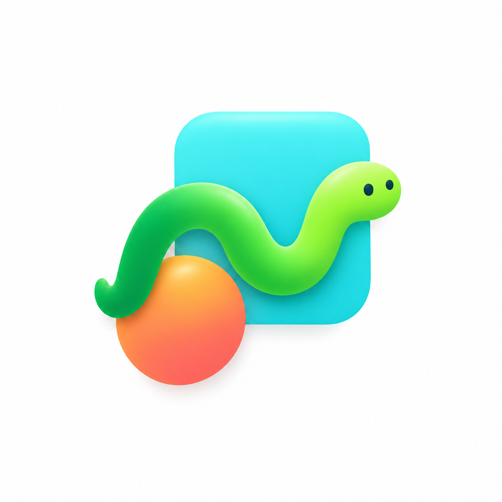

# 贪吃蛇



一个使用 SwiftUI 和 SpriteKit 开发的 macOS 原生贪吃蛇小游戏。深色棋盘搭配绿色界面，支持三档速度、键盘控制、暂停继续和本地最高分记录，可离线游玩。

## 功能

- **经典玩法**：24 × 24 格棋盘，吃食物增长，撞墙或撞到自己结束，填满棋盘即可通关。
- **三档难度**：悠闲、经典、极速，使用绿色胶囊按钮切换。
- **暂停与继续**：通过棋盘上方按钮、暂停浮层或空格键操作；窗口失焦或切换应用时自动暂停。
- **本地记录**：自动保存最高分、上次选择的难度及音效偏好。
- **音效反馈**：吃食物和游戏结束时播放音效，可通过底部音量按钮关闭。
- **原生窗口**：支持调整窗口大小，棋盘保持正方形。
- **应用图标**：打包时自动生成多尺寸 `.icns` 并写入应用包。

## 环境要求

- macOS 13 或更高版本。
- Swift 5.9 或更高版本的工具链。
- Apple Command Line Tools 或 Xcode。

项目使用 Swift Package Manager 管理，没有第三方依赖。构建脚本使用 AppKit 生成带透明圆角的图标，并使用 macOS 自带的 `iconutil` 和 `codesign` 完成打包。

尚未安装开发工具时，可先执行：

```sh
xcode-select --install
```

## 快速开始

在项目根目录执行：

```sh
./scripts/build-app.sh
open dist/贪吃蛇.app
```

构建完成后，会生成 `dist/贪吃蛇.app`，也可以在 Finder 中双击启动。

### 生成安装包

```sh
./scripts/build-dmg.sh
```

脚本会重新构建应用，生成 `dist/贪吃蛇-1.0.2-<架构>.dmg` 和对应的 `.sha256` 校验文件，并校验应用签名和磁盘映像完整性。打开 DMG 后，将 `贪吃蛇.app` 拖入其中的 `Applications` 入口即可安装，再从「应用程序」文件夹启动游戏。安装完成后可推出磁盘映像。旧版应用文件名为 `SnakeMac.app`，新版统一为 `贪吃蛇.app`；安装新版后可移除旧版应用及其 Dock 快捷方式，避免重复显示。

安装包包含当前机器架构的应用；例如 `arm64` 版本用于 Apple Silicon Mac。该安装包采用临时签名，尚未进行 Developer ID 签名和 Apple 公证。

开发时可以直接运行：

```sh
swift run SnakeMac
```

也可以用 Xcode 打开 `Package.swift`，选择 `SnakeMac` 可执行目标进行开发和调试。

## 操作说明

| 操作 | 快捷键或入口 |
| --- | --- |
| 向上 / 下 / 左 / 右移动 | 方向键或 W / S / A / D |
| 开始游戏 | 开始浮层按钮、回车或空格 |
| 暂停游戏 | 棋盘上方「暂停游戏」、空格或 Esc |
| 继续游戏 | 「继续游戏」按钮、回车或空格 |
| 结束后再来一局 | 结束浮层按钮、回车或空格 |
| 立即开始新游戏 | ⌘N，或菜单 File → 新游戏 |
| 切换难度 | 棋盘下方难度按钮，游戏开始前或结束后可切换 |
| 开关音效 | 棋盘下方音量按钮 |

开始与重开入口位于棋盘浮层中；右下角不再显示开始按钮。暂停后，恢复游戏需要手动操作。

## 规则与难度

初始蛇身长度为 3 格，向右移动。每吃到一个食物，蛇身增长 1 格，得分增加 10 分。食物只生成在空格中，不能直接掉头。

| 难度 | 每移动一格的间隔 | 适合体验 |
| --- | --- | --- |
| 悠闲 | 190 ms | 熟悉操作、从容规划路线 |
| 经典 | 130 ms | 标准节奏 |
| 极速 | 85 ms | 挑战反应与路线判断 |

一局中速度固定，暂停期间也不能切换难度。最高分由三档难度共用。

游戏逻辑采用固定时间步长；最多缓存两次有效转向，并在后续移动时依次执行。非增长回合允许进入尾巴正在腾出的格子。

## 本地数据

使用 `UserDefaults` 保存以下数据：

| 键名 | 内容 |
| --- | --- |
| `bestScore` | 最高分 |
| `difficulty` | 难度偏好 |
| `soundEnabled` | 音效开关 |

应用标识为 `com.local.snakemac`。当前不保存未完成的对局，退出后重新打开会回到待开始状态。

## 规则检查

```sh
./scripts/check.sh
```

脚本使用 `swiftc` 编译独立检查程序，无需 XCTest。成功时输出：

```text
Passed 8 game rule checks
```

检查覆盖待开始与暂停状态、反向输入与连续转向、增长计分、食物生成、撞墙、尾部腾空、撞身和填满棋盘通关。当前验证入口是上述脚本，未配置 `swift test` 测试目标。

## 项目结构

```text
.
├── Package.swift
├── Sources/
│   ├── SnakeCore/
│   │   └── GameEngine.swift          # 网格、移动、食物、碰撞和得分规则
│   └── SnakeMac/
│       ├── SnakeMacApp.swift        # 应用入口、界面和难度切换组件
│       ├── GameModel.swift          # 状态、输入、计时、音效及本地记录
│       └── SnakeScene.swift         # SpriteKit 棋盘和游戏元素渲染
├── Tests/SnakeCoreTests/
│   └── GameEngineTests.swift        # 独立规则检查程序
├── Assets/
│   ├── AppIcon-colorful-v3.png       # 当前打包使用的应用图标
│   └── AppIcon-colorful-v3-prompt.txt # 图标生成提示词
├── scripts/
│   ├── build-app.sh                 # 发布构建、图标转换、应用打包及签名
│   ├── build-dmg.sh                 # 生成拖拽安装 DMG 和 SHA-256 校验文件
│   ├── prepare-icon.swift           # 为图标添加圆角裁切与透明边距
│   └── check.sh                     # 编译并运行规则检查
└── dist/
    └── 贪吃蛇.app                 # 本机构建产物，不纳入版本控制
```

`SnakeCore` 独立于界面和渲染，修改玩法时可单独验证。历史图标版本保留在 `Assets/` 中。

## 应用图标

当前图标采用白底、青色圆角方块、橙色圆形与绿色蛇的叠层设计，使用内置 imagegen 生成。

- 图标源文件：[AppIcon-colorful-v3.png](Assets/AppIcon-colorful-v3.png)
- 生成提示词：[AppIcon-colorful-v3-prompt.txt](Assets/AppIcon-colorful-v3-prompt.txt)

更换图标时，更新 `scripts/build-app.sh` 中的源图片路径，然后重新构建。脚本先用 `prepare-icon.swift` 对源图应用圆角裁切和透明边距，再生成 16、32、128、256、512 点及对应 Retina 尺寸，转换为 `Contents/Resources/AppIcon.icns`，并配置 `CFBundleIconFile`。macOS 不会自动为 `.icns` 添加圆角，因此必须在每个尺寸中保留透明角。重新启动应用后查看更新效果。

## 打包说明

构建脚本生成当前机器架构的 Release 应用，并使用临时签名（ad hoc signing）。目前未配置 Universal Binary、Developer ID 签名、公证或 App Store 发布流程。

可手动校验应用签名：

```sh
codesign --verify --deep --strict dist/贪吃蛇.app
```

`.build/`、`.swiftpm/` 和 `dist/` 均已加入 `.gitignore`，可通过脚本重新生成构建产物。
